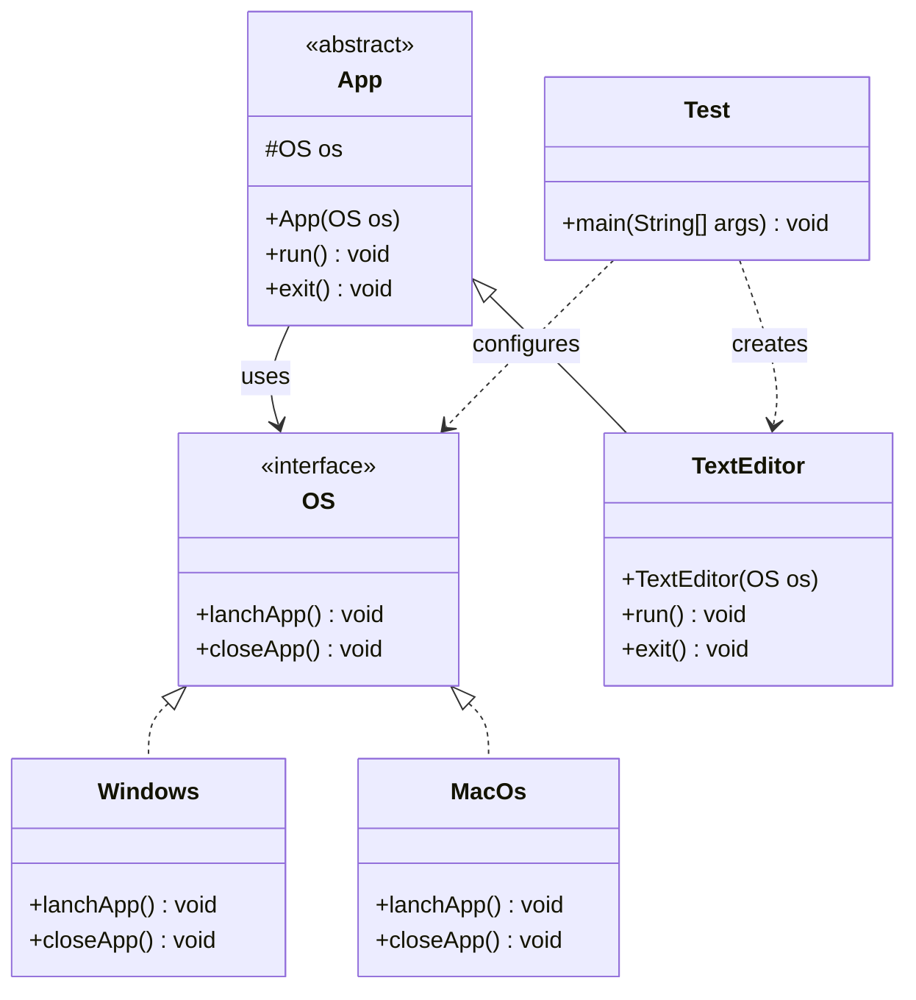
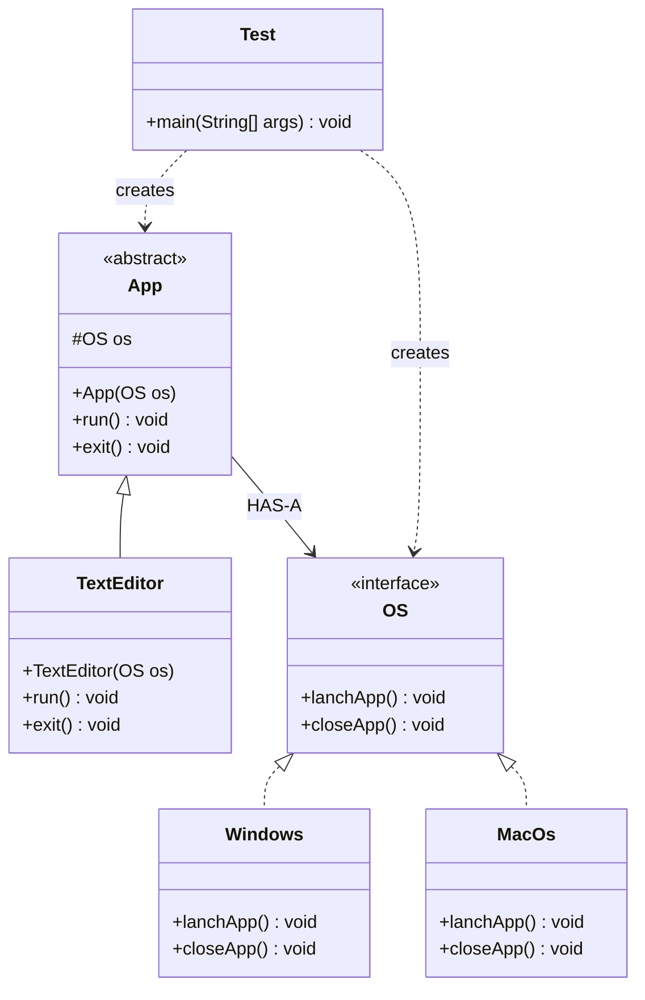

# Bridge Design Pattern


## 1. Introduction

Bridge is a **Structural Design Pattern** that separates an abstraction from its implementation so that both can vary independently.

It uses **composition instead of inheritance** to connect an abstraction with its implementation.

The Bridge Pattern is useful when an application needs to support multiple implementations without creating many subclasses.

## 2. Purpose

The main purpose of the Bridge Pattern is to separate high-level abstraction from platform-specific implementation.

It allows developers to:

- Separate abstraction from implementation.
- Develop abstractions and implementations independently.
- Avoid creating unnecessary subclasses.
- Use composition to connect different implementations.
- Improve code flexibility and maintainability.

## 3. Real-World Example

A **Cross-Platform Application System**.

An application such as a Text Editor can run on different operating systems, such as Windows and macOS.

Instead of creating separate classes like `WindowsTextEditor` and `MacTextEditor`, the Bridge Pattern allows us to separate the application from the operating system.

**Applications:**
- Text Editor

**Operating Systems:**
- Windows
- macOS

The same Text Editor application can work with different operating systems through a common `OS` interface.

## 4. Main Components

- **Implementor Interface:** `OS`
- **Concrete Implementors:** `Windows`, `MacOs`
- **Abstraction:** `App`
- **Refined Abstraction:** `TextEditor`
- **Client:** `Test` class

### Implementor Interface

The `OS` interface defines operations that must be implemented by different operating systems.

- `lanchApp()`
- `closeApp()`

### Concrete Implementors

The `Windows` and `MacOs` classes implement the `OS` interface and provide operating-system-specific behavior.

### Abstraction

The abstract `App` class maintains a reference to an `OS` object.

It declares the abstract methods:

- `run()`
- `exit()`

### Refined Abstraction

The `TextEditor` class extends `App` and provides implementations for `run()` and `exit()`.

It delegates operating-system-specific operations to the associated `OS` object.

### Client

The `Test` class creates operating system objects and connects them with the Text Editor application.

## 5. UML Class Diagram



## 6. How It Works

1. The `OS` interface declares the methods `lanchApp()` and `closeApp()`.
2. The `Windows` and `MacOs` classes implement the `OS` interface.
3. The abstract `App` class contains a protected reference to an `OS` object.
4. The `OS` implementation is passed to the `App` constructor.
5. The `TextEditor` class extends the `App` class.
6. The `run()` method displays a message and calls `os.lanchApp()`.
7. The `exit()` method displays a message and calls `os.closeApp()`.
8. The client creates `TextEditor` objects with different operating system implementations.
9. The same application abstraction works with different operating systems without modifying the `TextEditor` class.

## 7. Java Implementation Example

### Implementor Interface — OS

```java
interface OS {

    void lanchApp();

    void closeApp();
}
```

### Concrete Implementor — Windows

```java
class Windows implements OS {

    @Override
    public void lanchApp() {
        System.out.println("Windows App Lanching...");
    }

    @Override
    public void closeApp() {
        System.out.println("Windows App Close...");
    }
}
```

### Concrete Implementor — MacOs

```java
class MacOs implements OS {

    @Override
    public void lanchApp() {
        System.out.println("Mac App Lanching...");
    }

    @Override
    public void closeApp() {
        System.out.println("Mac App Close...");
    }
}
```

### Abstraction — App

```java
abstract class App {

    protected OS os;

    public App(OS os) {
        this.os = os;
    }

    public abstract void run();

    public abstract void exit();
}
```

### Refined Abstraction — TextEditor

```java
class TextEditor extends App {

    public TextEditor(OS os) {
        super(os);
    }

    @Override
    public void run() {
        System.out.println("TextEditor Running...");
        os.lanchApp();
    }

    @Override
    public void exit() {
        System.out.println("TextEditor Exit...");
        os.closeApp();
    }
}
```

### Client — Test

```java
public class Test {

    public static void main(String[] args) {

        OS windows = new Windows();
        OS macOs = new MacOs();

        App app1 = new TextEditor(windows);
        App app2 = new TextEditor(macOs);

        app1.run();
        app2.run();

        app1.run();
        app2.exit();
    }
}
```

## 8. Important Concept: Abstraction and Implementation Separation

The most important concept of the Bridge Pattern is separating abstraction from implementation.

In this example:

**Abstraction Side:**
- `App`
- `TextEditor`

**Implementation Side:**
- `OS`
- `Windows`
- `MacOs`

The `App` class maintains an `OS` reference.

```java
protected OS os;
```

The implementation is passed through the constructor.

```java
public App(OS os) {
    this.os = os;
}
```

This allows the application to work with different operating systems without changing the application logic.

## 9. Important Concept: Composition

The Bridge Pattern uses **Object Composition** to connect the abstraction and implementation.

```java
OS windows = new Windows();

App app = new TextEditor(windows);

app.run();
```

### Explanation

1. A `Windows` object is created.
2. The object is passed into the `TextEditor` constructor.
3. The `TextEditor` stores the operating system reference through its parent class.
4. When `run()` is called, the Text Editor delegates the launching operation to Windows.

The same application can use macOS:

```java
OS macOs = new MacOs();

App app = new TextEditor(macOs);

app.run();
```

The `TextEditor` class does not need to be modified to support a different operating system.

## 10. Important Concept: Independent Variation

The Bridge Pattern allows two dimensions to evolve independently.

### Abstraction Side

New application types can be added by extending `App`.

Examples:
- `TextEditor`
- `MediaPlayer`
- `WebBrowser`

### Implementation Side

New operating systems can be added by implementing `OS`.

Examples:
- `Windows`
- `MacOs`
- `Linux`

This avoids creating separate subclasses for every possible application and operating system combination.

## 11. Advantages

- Separates abstraction from implementation.
- Allows both sides to change independently.
- Reduces unnecessary subclassing.
- Supports the Open/Closed Principle.
- Improves flexibility and maintainability.
- Promotes object composition.
- Makes it easier to introduce new implementations.

## 12. Disadvantages

- Increases the number of interfaces and classes.
- Can make the initial design more complex.
- May be unnecessary for small applications with only one implementation.
- Requires careful identification of abstraction and implementation responsibilities.

## 13. Example Output

```text
TextEditor Running...
Windows App Lanching...
TextEditor Running...
Mac App Lanching...
TextEditor Running...
Windows App Lanching...
TextEditor Exit...
Mac App Close...
```

## 14. Conclusion

The Bridge Design Pattern provides a flexible way to separate an abstraction from its implementation.

In this practical example, a Text Editor application can operate on different operating systems through the `OS` interface.

The pattern demonstrates how **Abstraction, Composition, Delegation, and Polymorphism** can be used to build flexible, reusable, and maintainable object-oriented applications.


## 5. UML Class Diagram


