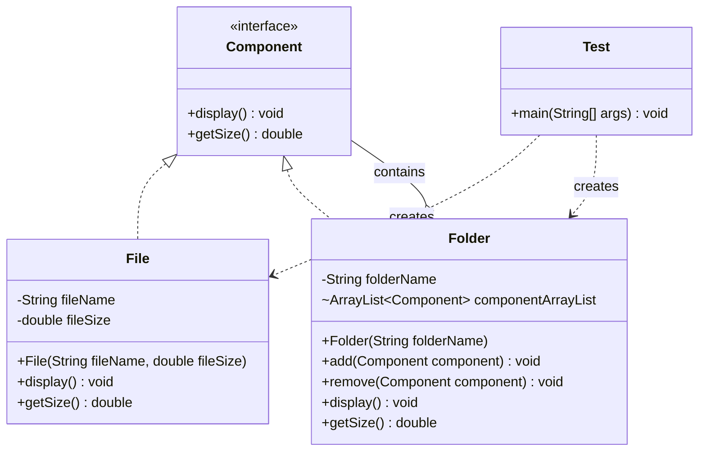

# Composite Design Pattern


## 1. Introduction

Composite is a **Structural Design Pattern** that allows individual objects and groups of objects to be treated uniformly.

It organizes objects into tree-like structures to represent **part-whole hierarchies**.

## 2. Purpose

The main purpose of the Composite Pattern is to treat individual objects (Leaf) and collections of objects (Composite) through a common interface.

It allows clients to perform operations on both individual objects and groups of objects without distinguishing between them.

## 3. Real-World Example

A **File and Folder Management System**.

A computer file system contains files and folders.

- **File** – Represents an individual file with a name and size.
- **Folder** – Can contain multiple files and other folders.
- **Component** – Common interface for both files and folders.

The system can display the file structure and calculate the total size of a folder, including all nested files and subfolders.

## 4. Main Components

- **Component Interface:** `Component`
- **Leaf:** `File`
- **Composite:** `Folder`
- **Client:** `Test` class

### Component

Defines the common operations `display()` and `getSize()` for files and folders.

### Leaf

The `File` class represents an individual file.

It stores the file name and size and returns its own size when `getSize()` is called.

### Composite

The `Folder` class maintains an `ArrayList<Component>` containing files and subfolders.

It supports adding, removing, displaying, and calculating the total size of its child components.

### Client

The `Test` class creates files and folders, organizes them into a hierarchy, and executes the operations.

## 5. UML Class Diagram



## 6. How It Works

1. The `Component` interface declares two methods: `display()` and `getSize()`.
2. The `File` class implements `Component` and represents an individual file.
3. Each file stores its file name and size.
4. The `Folder` class implements `Component` and maintains a collection of child components.
5. Files and subfolders are added using the `add()` method.
6. Calling `display()` on a folder displays its name and recursively displays all child components.
7. Calling `getSize()` on a folder recursively calculates the total size of its files and subfolders.
8. The client accesses both files and folders through the common `Component` interface.

## 7. File and Folder Structure

```text
Desktop (Composite)
│
├── Documents (Composite)
│   ├── Note.txt (Leaf)       - 1.5
│   └── Report.pdf (Leaf)     - 2.0
│
├── Game.exe (Leaf)           - 2048.0
│
└── Images (Composite)
    └── Photo.jpg (Leaf)      - 1.5
```

## 8. Important Concept: Recursive Composition

One of the most important concepts of the Composite Pattern is **Recursion**.

In this example, the `Folder` class calculates the total size of all child components recursively.

```java
@Override
public double getSize() {

    double total = 0;

    for (Component component : componentArrayList) {
        total += component.getSize();
    }

    return total;
}
```

### Explanation

- If the child component is a `File`, `getSize()` returns its file size.
- If the child component is a `Folder`, `getSize()` calculates the total size of its children.
- This process continues recursively until all nested components are processed.

### Size Calculation

| Component | Size |
|---|---:|
| Note.txt | 1.5 |
| Report.pdf | 2.0 |
| Game.exe | 2048.0 |
| Photo.jpg | 1.5 |
| **Total Desktop Size** | **2053.0** |

## 9. Object Composition

The Composite Pattern uses object composition to build hierarchical structures.

```java
Folder desktopFolder = new Folder("Desktop");
Folder documentsFolder = new Folder("Documents");

File noteFile = new File("Note.txt", 1.5);

documentsFolder.add(noteFile);
desktopFolder.add(documentsFolder);
```

Here:

- `desktopFolder` contains `documentsFolder`.
- `documentsFolder` contains `noteFile`.
- Both `File` and `Folder` implement the `Component` interface.
- The client can execute common operations on both types.

## 10. Advantages

- Treats individual objects and groups of objects uniformly.
- Simplifies client code.
- Supports recursive tree structures.
- Makes it easier to add new component types.
- Follows the Open/Closed Principle.
- Improves flexibility and maintainability.
- Supports code reusability through polymorphism.

## 11. Disadvantages

- Can make the design more complex for simple applications.
- May be difficult to restrict the types of components allowed in a folder.
- Recursive operations can become expensive for very large structures.
- Shared interfaces may contain operations that are not suitable for every component.

## 12. Example Output

```text
Folder Name: Desktop
Folder Name: Documents
File Name: Note.txtFile Size :1.5
File Name: Report.pdfFile Size :2.0
File Name: Game.exeFile Size :2048.0
Folder Name: Images
File Name: Photo.jpgFile Size :1.5
--------------------
Total Size: 2053.0
```

## 13. Composite vs Decorator Pattern

Both Composite and Decorator are Structural Design Patterns.

| Composite Pattern | Decorator Pattern |
|---|---|
| Organizes objects into tree structures | Adds new functionality to objects |
| Represents part-whole hierarchies | Extends object behavior dynamically |
| Can contain multiple child objects | Typically wraps one component |
| Example: File and Folder System | Example: Ice Cream Toppings |

## 14. Conclusion

The Composite Design Pattern provides a flexible way to manage individual objects and groups of objects through a common interface.

In this practical example, files and folders are organized into a hierarchical structure.

The system demonstrates how **Recursion, Composition, and Polymorphism** can be used to display file structures and calculate folder sizes efficiently.
