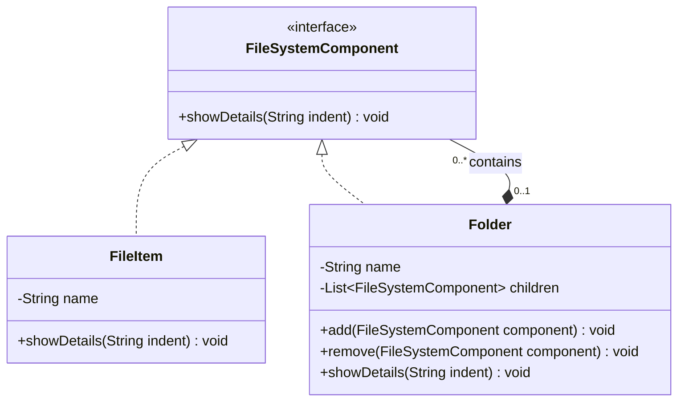

# Composite Design Pattern


## 1. Introduction

Composite is a **Structural Design Pattern** that allows individual objects and groups of objects to be treated uniformly.

It organizes objects into tree-like structures to represent **part-whole hierarchies**.

## 2. Purpose

The main purpose of the Composite Pattern is to treat individual objects (**Leaf**) and collections of objects (**Composite**) through a common interface.

It allows clients to work with both simple and complex objects in a consistent way.

## 3. Real-World Example

A **File and Folder Management System**.

A computer file system contains files and folders.

- **File** – Represents an individual file.
- **Folder** – Can contain multiple files and other folders.
- **FileSystemComponent** – Common interface for files and folders.

A folder can contain both files and subfolders, forming a hierarchical tree structure.

## 4. Main Components

- **Component Interface:** `FileSystemComponent`
- **Leaf:** `FileItem`
- **Composite:** `Folder`
- **Client:** `Main` class

### Component
Defines the common interface for both leaf and composite objects.

### Leaf
Represents an individual object that does not contain child components.

### Composite
Represents a group of objects and can contain both Leaf and Composite objects.

### Client
Interacts with objects through the common component interface.

## 5. UML Class Diagram



## 6. How It Works

1. The `FileSystemComponent` interface defines the common `showDetails()` method.
2. The `FileItem` class implements the interface and represents an individual file.
3. The `Folder` class also implements the interface and maintains a collection of `FileSystemComponent` objects.
4. The `Folder` class provides `add()` and `remove()` methods to manage child components.
5. A folder can contain both `FileItem` and other `Folder` objects.
6. When `showDetails()` is called on a folder, it recursively calls the same method on all its children.
7. The client can treat individual files and folders uniformly through the common interface.

## 7. Java Implementation Example

### Component Interface

```java
interface FileSystemComponent {
    void showDetails(String indent);
}
```

### Leaf Class

```java
class FileItem implements FileSystemComponent {

    private String name;

    public FileItem(String name) {
        this.name = name;
    }

    @Override
    public void showDetails(String indent) {
        System.out.println(indent + "File: " + name);
    }
}
```

### Composite Class

```java
import java.util.ArrayList;
import java.util.List;

class Folder implements FileSystemComponent {

    private String name;

    private List<FileSystemComponent> children = new ArrayList<>();

    public Folder(String name) {
        this.name = name;
    }

    public void add(FileSystemComponent component) {
        children.add(component);
    }

    public void remove(FileSystemComponent component) {
        children.remove(component);
    }

    @Override
    public void showDetails(String indent) {

        System.out.println(indent + "Folder: " + name);

        for (FileSystemComponent component : children) {
            component.showDetails(indent + "  ");
        }
    }
}
```

### Client Class

```java
public class Main {

    public static void main(String[] args) {

        Folder root = new Folder("Projects");

        Folder src = new Folder("src");

        FileSystemComponent file1 = new FileItem("Main.java");
        FileSystemComponent file2 = new FileItem("Composite.java");
        FileSystemComponent file3 = new FileItem("README.md");

        src.add(file1);
        src.add(file2);

        root.add(src);
        root.add(file3);

        root.showDetails("");
    }
}
```

## 8. Tree Structure

The Composite Pattern represents objects in a hierarchical tree structure.

```text
Projects (Composite)
│
├── src (Composite)
│   ├── Main.java (Leaf)
│   └── Composite.java (Leaf)
│
└── README.md (Leaf)
```

In this structure:

- `Projects` is the root composite.
- `src` is a nested composite.
- `Main.java`, `Composite.java`, and `README.md` are leaf objects.
- Each composite can contain multiple child components.

## 9. Important Concept: Recursive Composition

One of the most important concepts of the Composite Pattern is **Recursive Composition**.

A composite object can contain other composite objects.

```java
Folder mainFolder = new Folder("Main Folder");
Folder subFolder = new Folder("Sub Folder");

mainFolder.add(subFolder);
subFolder.add(new FileItem("Test.java"));

mainFolder.showDetails("");
```

Here:

1. `mainFolder` contains `subFolder`.
2. `subFolder` contains an individual file.
3. Calling `showDetails()` on `mainFolder` processes its nested components recursively.

This demonstrates how complex tree structures can be managed through a common interface.

## 10. Advantages

- Treats individual objects and groups of objects uniformly.
- Simplifies client code.
- Supports recursive tree structures.
- Makes it easier to add new component types.
- Follows the Open/Closed Principle.
- Improves flexibility and maintainability.

## 11. Disadvantages

- Can make the design more complex for simple applications.
- May be difficult to enforce restrictions on certain component types.
- Can make the common interface difficult to design.
- Deep recursive structures may affect performance.

## 12. Example Output

```text
Folder: Projects
  Folder: src
    File: Main.java
    File: Composite.java
  File: README.md
```

## 13. Composite vs Decorator Pattern

Both Composite and Decorator are Structural Design Patterns.

| Composite Pattern | Decorator Pattern |
|---|---|
| Organizes objects into tree structures | Adds functionality to objects |
| Represents part-whole hierarchies | Extends object behavior dynamically |
| Can contain multiple child objects | Typically wraps one component |
| Example: File and Folder System | Example: Ice Cream Toppings |

## 14. Conclusion

The Composite Design Pattern provides an effective way to manage individual objects and collections of objects using a common interface.

In this practical example, files and folders are organized into a hierarchical tree structure.

The pattern demonstrates how **Recursion, Composition, and Polymorphism** can be used to build flexible, scalable, and maintainable object-oriented applications.
