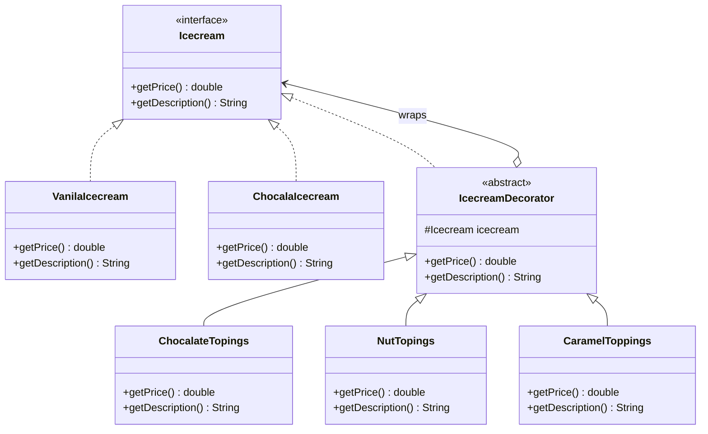

# Decorator Design Pattern


## 1. Introduction

Decorator is a **Structural Design Pattern** that allows new responsibilities or behaviors to be added to an object dynamically without modifying its existing code.

It provides a flexible alternative to inheritance for extending object functionality.

## 2. Purpose

The main purpose of the Decorator Pattern is to dynamically add additional features to objects by wrapping them with decorator objects.

It allows developers to extend an object's behavior without changing its original class.

## 3. Real-World Example

An **Ice Cream Ordering System**.

Customers can select a basic ice cream and customize it by adding different toppings.

**Base Ice Cream:**
- Vanilla Ice Cream – Rs. 100
- Chocolate Ice Cream – Rs. 150

**Additional Toppings:**
- Chocolate Topping – Rs. 50
- Nut Topping – Rs. 25
- Caramel Topping – Rs. 75

Each topping adds an additional cost and description to the selected ice cream.

## 4. Main Components

- **Component Interface:** `Icecream`
- **Concrete Components:** `VanilaIcecream`, `ChocalaIcecream`
- **Abstract Decorator:** `IcecreamDecorator`
- **Concrete Decorators:** `ChocalateTopings`, `NutTopings`, `CaramelToppings`
- **Client:** `Test` class

## 5. UML Class Diagram



## 6. How It Works

1. The `Icecream` interface defines common methods: `getPrice()` and `getDescription()`.
2. The `VanilaIcecream` and `ChocalaIcecream` classes provide the basic ice cream implementations.
3. The abstract `IcecreamDecorator` class implements the `Icecream` interface and holds a reference to another `Icecream` object.
4. Concrete decorators extend `IcecreamDecorator`.
5. Each decorator adds its own price and description to the wrapped ice cream.
6. Multiple decorators can be combined to add several toppings dynamically.

## 7. Java Implementation Example

```java
Icecream icecream = new VanilaIcecream();

// Add chocolate topping
icecream = new ChocalateTopings(icecream);

// Add nut topping
icecream = new NutTopings(icecream);

// Add caramel topping
icecream = new CaramelToppings(icecream);

System.out.println(icecream.getDescription());
System.out.println("Total Price: Rs. " + icecream.getPrice());
```

### Price Calculation

| Item | Price |
|---|---:|
| Vanilla Ice Cream | Rs. 100 |
| Chocolate Topping | Rs. 50 |
| Nut Topping | Rs. 25 |
| Caramel Topping | Rs. 75 |
| **Total** | **Rs. 250** |

## 8. Important Concept: Object Wrapping

The Decorator Pattern uses **Object Wrapping** to extend functionality.

```java
Icecream icecream = new VanilaIcecream();
icecream = new ChocalateTopings(icecream);
```

In this example:

- `VanilaIcecream` is the original component.
- `ChocalateTopings` is a decorator.
- The decorator wraps the original ice cream object.
- The existing functionality is preserved while additional functionality is added.

This process can be repeated with multiple decorators.

## 9. Advantages

- Adds new functionality dynamically without modifying existing classes.
- Follows the Open/Closed Principle.
- Reduces the need for excessive subclassing.
- Allows multiple decorators to be combined.
- Encourages flexible and reusable code.
- Supports the Single Responsibility Principle.

## 10. Disadvantages

- Can increase the number of classes.
- Multiple layers of decorators may make debugging more difficult.
- The order of wrapping may affect behavior in some implementations.
- Object structures can become more complex.

## 11. Example Output

For vanilla ice cream with chocolate, nut, and caramel toppings:

```text
Vanila Ice cream With Chocolate Topping With Nut Topping With Caramel Topping

Total Price: Rs. 250.0
```

*The output illustrates the expected result. Exact description text depends on the decorator implementations.*

## 12. Conclusion

The Decorator Design Pattern provides a flexible way to extend object functionality without modifying existing classes.

In this practical example, different toppings can be added dynamically to ice cream objects using decorators.

This demonstrates how **Object Composition and Delegation** can be used to build flexible and maintainable applications.
