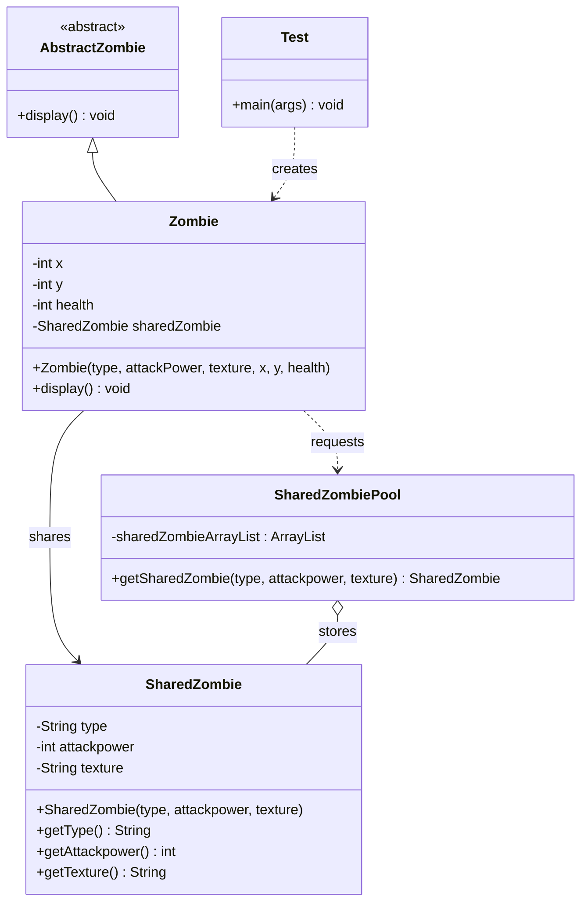

# Flyweight Design Pattern

### Java Implementation | UML Class Diagram | Zombie Game Example

**Developed by: L.W Rasheeda Idusara**

## 1. Introduction

The **Flyweight Design Pattern** is a Structural Design Pattern that reduces memory usage by sharing common data between multiple objects instead of creating separate copies of the same data.

It is particularly useful when an application needs to create a large number of similar objects that share common characteristics.

## 2. Purpose

The main purpose of the Flyweight Pattern is to optimize memory usage by separating shared data from object-specific data.

It allows developers to:

- Reduce memory consumption.
- Share common data between multiple objects.
- Avoid unnecessary object duplication.
- Improve memory efficiency when managing large numbers of similar objects.
- Separate intrinsic and extrinsic states.

## 3. Real-World Example

A **Zombie Game Management System**.

Imagine a game containing hundreds or thousands of zombies.

Each zombie has common characteristics such as:

- Zombie Type
- Attack Power
- Texture

However, every zombie also has individual properties such as:

- Position X
- Position Y
- Health

Instead of storing the same type, attack power, and texture separately for every zombie, the Flyweight Pattern allows these properties to be shared.

### Example

Three IceZombies can share the same `SharedZombie` object while maintaining different positions and health values.

This reduces unnecessary duplication of common data.

## 4. Main Components

- **Abstract Context:** `AbstractZombie`
- **Concrete Context:** `Zombie`
- **Flyweight:** `SharedZombie`
- **Flyweight Factory:** `SharedZombiePool`
- **Client:** `Test` class

### AbstractZombie

The `AbstractZombie` class defines a common abstract `display()` method.

### Zombie

The `Zombie` class represents an individual zombie.

It stores the unique properties of each zombie and maintains a reference to a shared `SharedZombie` object.

### SharedZombie

The `SharedZombie` class stores common properties shared between zombies.

These properties include:

- `type`
- `attackpower`
- `texture`

### SharedZombiePool

The `SharedZombiePool` class manages reusable `SharedZombie` objects using an `ArrayList`.

Before creating a new shared object, it checks whether an object with the same properties already exists.

### Test

The `Test` class creates zombie objects and demonstrates how shared objects are reused.

## 5. UML Class Diagram



## 6. How It Works

1. The `AbstractZombie` class declares an abstract `display()` method.
2. The `SharedZombie` class stores common zombie properties.
3. The `SharedZombiePool` maintains a collection of shared zombie objects.
4. When a `Zombie` object is created, its constructor requests shared data from `SharedZombiePool`.
5. The pool searches for an existing `SharedZombie` object with matching properties.
6. If a matching object exists, the pool returns the existing object.
7. Otherwise, a new `SharedZombie` object is created and stored in the pool.
8. Each zombie stores its individual position and health values separately.
9. Multiple zombies can reference the same shared object.

## 7. Important Concept: Intrinsic and Extrinsic State

The Flyweight Pattern separates data into two categories.

### Intrinsic State (Shared Data)

Intrinsic state represents information that can be shared between multiple objects.

In this example:

```java
class SharedZombie {

    private String type;
    private int attackpower;
    private String texture;

}
```

These values are stored inside the `SharedZombie` class.

Zombies with identical shared properties can reference the same object.

### Extrinsic State (Unique Data)

Extrinsic state represents information that belongs to each individual object.

```java
class Zombie extends AbstractZombie {

    private int x;
    private int y;
    private int health;

    private SharedZombie sharedZombie;

}
```

Here:

- `x` represents the horizontal position.
- `y` represents the vertical position.
- `health` represents the zombie's individual health.

These values are maintained separately for each zombie.

## 8. Java Implementation

### Flyweight Factory — SharedZombiePool

```java
class SharedZombiePool {

    private static final ArrayList<SharedZombie>
        sharedZombieArrayList = new ArrayList<>();

    public static SharedZombie getSharedZombie(
            String type,
            int attackpower,
            String texture) {

        SharedZombie sz = null;

        for (SharedZombie szItem : sharedZombieArrayList) {

            if (type.equals(szItem.getType())
                    && attackpower == szItem.getAttackpower()
                    && texture.equals(szItem.getTexture())) {

                sz = szItem;
                break;
            }
        }

        if (sz == null) {
            sz = new SharedZombie(type, attackpower, texture);
            sharedZombieArrayList.add(sz);
        }

        return sz;
    }
}
```

### Client Implementation

```java
public class Test {

    public static void main(String[] args) {

        Zombie z1 = new Zombie(
            "IceZombie", 10, "blue color", 250, 250, 100
        );

        Zombie z2 = new Zombie(
            "FireZombie", 20, "blue color", 500, 250, 100
        );

        Zombie z3 = new Zombie(
            "IceZombie", 10, "blue color", 500, 250, 95
        );

        Zombie z4 = new Zombie(
            "IceZombie", 10, "blue color", 750, 250, 100
        );

        z1.display();
        z2.display();
        z3.display();
        z4.display();
    }
}
```

## 9. Object Sharing Explanation

Consider the four zombies created in the application.

| Zombie | Type | Attack Power | Texture | Position | Health |
|---|---|---|---|---|---|
| z1 | IceZombie | 10 | blue color | (250, 250) | 100 |
| z2 | FireZombie | 20 | blue color | (500, 250) | 100 |
| z3 | IceZombie | 10 | blue color | (500, 250) | 95 |
| z4 | IceZombie | 10 | blue color | (750, 250) | 100 |

### Shared Object Reuse

```text
SharedZombiePool
│
├── SharedZombie (IceZombie, 10, blue color)
│   │
│   ├── Zombie z1
│   ├── Zombie z3
│   └── Zombie z4
│
└── SharedZombie (FireZombie, 20, blue color)
    │
    └── Zombie z2
```

Although four `Zombie` objects are created, only two `SharedZombie` objects are required.

**Total Zombie Objects:** 4

**Total SharedZombie Objects:** 2

This demonstrates how the Flyweight Pattern eliminates unnecessary duplication of shared data.

## 10. Important Concept: Object Reusability

The key operation in this implementation is:

```java
this.sharedZombie =
    SharedZombiePool.getSharedZombie(
        type, attackPower, texture
    );
```

When the same shared properties are requested again, the factory returns the existing `SharedZombie` object.

This approach is known as **Object Sharing**.

The shared data is reused while individual zombie objects maintain their own unique state.

## 11. Advantages

- Reduces memory consumption by sharing common data.
- Avoids unnecessary duplication of objects.
- Supports efficient management of large numbers of similar objects.
- Separates intrinsic and extrinsic state.
- Encourages object reuse.
- Can improve application scalability in memory-intensive systems.

## 12. Disadvantages

- Introduces additional implementation complexity.
- Requires careful separation of intrinsic and extrinsic states.
- Shared objects should not be modified in ways that unexpectedly affect other objects.
- Managing shared objects requires additional logic.
- Searching for existing objects may introduce processing overhead.

## 13. Example Output

```text
Type : IceZombie
Attack Power : 10
Texture : blue color
Position X : 250
Position Y : 250
Health : 100

Type : FireZombie
Attack Power : 20
Texture : blue color
Position X : 500
Position Y : 250
Health : 100

Type : IceZombie
Attack Power : 10
Texture : blue color
Position X : 500
Position Y : 250
Health : 95

Type : IceZombie
Attack Power : 10
Texture : blue color
Position X : 750
Position Y : 250
Health : 100
```

## 14. Flyweight vs Prototype Pattern

| Flyweight Pattern | Prototype Pattern |
|---|---|
| Shares existing objects or common state | Creates new objects by cloning existing objects |
| Focuses on memory optimization through sharing | Focuses on object creation through copying |
| Multiple objects can reference the same shared object | Cloning generally creates a distinct object |
| Example: Shared zombie characteristics | Example: Cloning a game character |

## 15. Conclusion

The Flyweight Design Pattern is an effective solution for reducing memory usage when an application contains many similar objects.

In this practical example, multiple zombies share common characteristics such as type, attack power, and texture while maintaining their individual positions and health values.

The implementation demonstrates how **Object Sharing, Intrinsic State, Extrinsic State, and the Flyweight Factory** can be used to design memory-efficient object-oriented applications.

---

### Author

**L.W Rasheeda Idusara**

[GitHub Profile](https://github.com/RasheedaIdusara)

**Happy Coding!**
