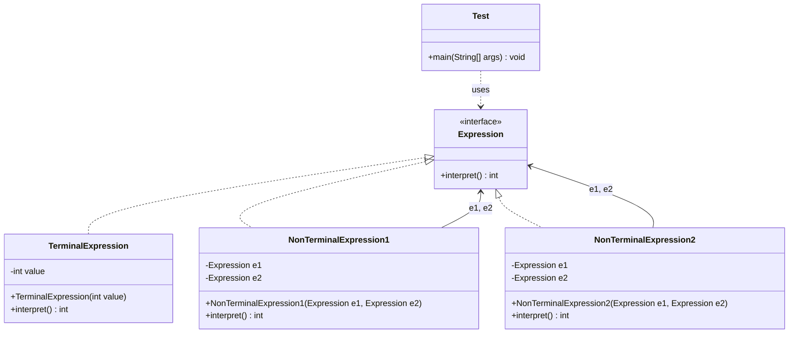

# Interpreter Design Pattern


### Java Implementation | UML Class Diagram | Arithmetic Expression Evaluation

**Developed by: L.W Rasheeda Idusara**

## 1. Introduction

The **Interpreter Design Pattern** is a Behavioral Design Pattern that defines a representation for a language's grammar and provides a mechanism to interpret expressions written in that language.

It allows complex expressions to be represented using objects and evaluated through a common interface.

This implementation demonstrates how arithmetic expressions can be evaluated using **Recursion, Polymorphism, and Object Composition**.

## 2. Purpose

The main purpose of the Interpreter Pattern is to define a grammar using classes and interpret expressions based on that grammar.

It allows developers to:

- Represent expressions as objects.
- Evaluate simple and complex expressions.
- Combine multiple expressions into larger expressions.
- Use recursion to evaluate nested expressions.
- Extend the system with additional expression types.

## 3. Real-World Example

A **Simple Arithmetic Expression Evaluator**.

Consider the mathematical expression:

```text
10 + 20
```

This expression contains two types of elements:

**Terminal Expressions:**
- `10`
- `20`

**Non-Terminal Expression:**
- `+` (Addition)

A terminal expression represents an individual value, while a non-terminal expression combines smaller expressions to perform an operation.

This implementation supports:

- Addition (`+`)
- Subtraction (`-`)
- Nested arithmetic expressions

## 4. Main Components

- **Abstract Expression:** `Expression` interface
- **Terminal Expression:** `TerminalExpression`
- **Non-Terminal Expression (Addition):** `NonTerminalExpression1`
- **Non-Terminal Expression (Subtraction):** `NonTerminalExpression2`
- **Client:** `Test` class

### Expression Interface

Defines the common method:

```java
int interpret();
```

All expression classes implement this interface.

### TerminalExpression

Represents a single integer value.

It returns the stored value when `interpret()` is called.

### NonTerminalExpression1

Represents an addition operation.

It contains two expressions and returns the sum of their interpreted results.

### NonTerminalExpression2

Represents a subtraction operation.

It contains two expressions and returns the difference between their interpreted results.

### Test Class

Creates expression objects and evaluates them through the `Expression` interface.

## 5. UML Class Diagram



## 6. How It Works

1. The `Expression` interface defines the `interpret()` method.
2. `TerminalExpression` represents an individual integer value.
3. `NonTerminalExpression1` represents addition between two expressions.
4. `NonTerminalExpression2` represents subtraction between two expressions.
5. Each non-terminal expression contains references to two `Expression` objects.
6. Calling `interpret()` on a non-terminal expression recursively evaluates its child expressions.
7. Java polymorphism ensures that the correct `interpret()` implementation is executed.
8. The final result is returned to the client.

## 7. Java Implementation

### Expression Interface

```java
interface Expression {
    int interpret();
}
```

### Terminal Expression

```java
class TerminalExpression implements Expression {

    private int value;

    public TerminalExpression(int value) {
        this.value = value;
    }

    @Override
    public int interpret() {
        return this.value;
    }
}
```

### Non-Terminal Expression 1 — Addition

```java
class NonTerminalExpression1 implements Expression {

    private Expression e1;
    private Expression e2;

    public NonTerminalExpression1(Expression e1, Expression e2) {
        this.e1 = e1;
        this.e2 = e2;
    }

    @Override
    public int interpret() {
        return e1.interpret() + e2.interpret();
    }
}
```

### Non-Terminal Expression 2 — Subtraction

```java
class NonTerminalExpression2 implements Expression {

    private Expression e1;
    private Expression e2;

    public NonTerminalExpression2(Expression e1, Expression e2) {
        this.e1 = e1;
        this.e2 = e2;
    }

    @Override
    public int interpret() {
        return e1.interpret() - e2.interpret();
    }
}
```

### Client — Test

```java
public class Test {

    public static void main(String[] args) {

        Expression e1 = new NonTerminalExpression1(
            new TerminalExpression(10),
            new TerminalExpression(20)
        );

        Expression e2 = new NonTerminalExpression2(
            new NonTerminalExpression2(
                new TerminalExpression(10),
                new TerminalExpression(20)
            ),
            new TerminalExpression(50)
        );

        System.out.println(e1.interpret());
        System.out.println(e2.interpret());
    }
}
```

## 8. Expression Tree Structure

### Example 1 — Addition

Expression:

```text
10 + 20
```

Tree representation:

```text
       (+)
      /   \
    10     20
```

Evaluation:

```text
10 + 20 = 30
```

### Example 2 — Nested Subtraction

Expression:

```text
(10 - 20) - 50
```

Tree representation:

```text
           (-)
          /   \
        (-)    50
       /   \
     10     20
```

Evaluation:

```text
Step 1: 10 - 20 = -10
Step 2: -10 - 50 = -60

Final Result = -60
```

The interpreter evaluates the nested expression first and then uses its result in the outer expression.

## 9. Important Concept: Recursion

Recursion is one of the most important concepts used in the Interpreter Pattern.

In this implementation, a non-terminal expression evaluates its child expressions by calling their `interpret()` methods.

```java
@Override
public int interpret() {
    return e1.interpret() + e2.interpret();
}
```

### Explanation

1. The current expression calls `interpret()` on its child expressions.
2. If a child is another non-terminal expression, it recursively evaluates its own children.
3. If a child is a terminal expression, it returns its stored integer value.
4. The parent expression combines the returned results.
5. The process continues until the complete expression is evaluated.

This allows the system to evaluate expressions with multiple levels of nesting.

## 10. Important Concept: Polymorphism

The Interpreter Pattern uses polymorphism through the common `Expression` interface.

```java
Expression e1 = new TerminalExpression(10);

Expression e2 = new NonTerminalExpression1(
    new TerminalExpression(10),
    new TerminalExpression(20)
);
```

Although both variables use the `Expression` interface, they reference different concrete implementations.

When `interpret()` is called, Java executes the implementation belonging to the actual object.

This allows expression objects to be combined without depending directly on their concrete classes.

## 11. Important Concept: Object Composition

Non-terminal expressions contain other expression objects.

```java
private Expression e1;
private Expression e2;
```

This is an example of **Object Composition**.

Each non-terminal expression can contain:

- Two terminal expressions.
- Two non-terminal expressions.
- A terminal expression and a non-terminal expression.

This structure allows complex arithmetic expressions to be built from smaller expressions.

## 12. Advantages

- Separates expression representation from evaluation logic.
- Supports recursive evaluation of nested expressions.
- Makes it easier to introduce additional expression types.
- Encourages polymorphism and object composition.
- Provides a structured approach to implementing simple grammars.
- Supports reusable expression objects.

## 13. Disadvantages

- Can introduce many classes for complex grammars.
- Becomes difficult to maintain when the grammar contains many rules.
- Deeply nested expressions may increase recursion overhead.
- May not be suitable for complex programming language parsers.
- Requires additional components to parse expressions from text.

## 14. Example Output

```text
30
-60
```

### Output Explanation

| Expression | Calculation | Result |
|---|---|---:|
| e1 | 10 + 20 | 30 |
| e2 | (10 - 20) - 50 | -60 |

## 15. Current Implementation Limitations

This practical implementation demonstrates a simplified arithmetic grammar.

Currently, it:

- Supports integer values.
- Supports addition and subtraction.
- Supports nested expression objects.
- Constructs expression trees directly in Java code.

It does not currently parse arithmetic expressions entered as strings or support multiplication and division.

These features could be introduced as future enhancements.

## 16. Conclusion

The Interpreter Design Pattern provides a structured approach to representing and evaluating expressions using objects.

In this practical example, arithmetic expressions are represented using terminal and non-terminal expression classes.

The implementation demonstrates how **Recursion, Polymorphism, and Object Composition** work together to evaluate complex expressions through a common interface.

---

### Author

**L.W Rasheeda Idusara**

[GitHub Profile](https://github.com/RasheedaIdusara)

**Happy Coding!**
