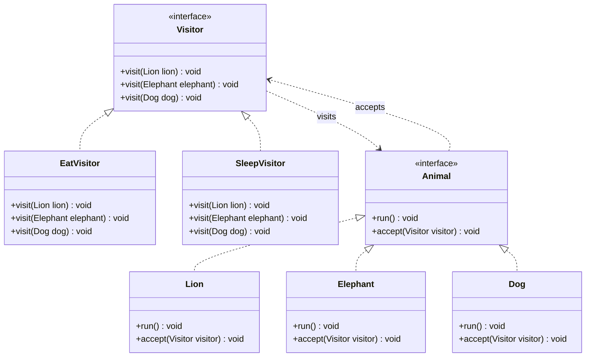

# Visitor Design Pattern

## 1. Introduction
Visitor is a Behavioral Design Pattern that allows new operations to be added to existing object structures without modifying their classes.

## 2. Purpose
The main purpose of the Visitor Pattern is to separate operations from the objects on which they operate.

It allows different operations to be performed on objects using separate visitor classes.

## 3. Real-World Example
An Animal Management System.

Different animals, such as Lions, Elephants, and Dogs, can perform various activities.

- **Lion** – An animal object
- **Elephant** – An animal object
- **Dog** – An animal object
- **EatVisitor** – Performs eating operations
- **SleepVisitor** – Performs sleeping operations

## 4. Main Components

- **Visitor Interface:** `Visitor`
- **Concrete Visitors:** `EatVisitor`, `SleepVisitor`
- **Element Interface:** `Animal`
- **Concrete Elements:** `Lion`, `Elephant`, `Dog`
- **Client:** `Test` class

## 5. UML Class Diagram



## 6. How It Works

1. The `Visitor` interface defines visit methods for different animal types.
2. The `Animal` interface declares an `accept(Visitor visitor)` method.
3. The `Lion`, `Elephant`, and `Dog` classes implement the `Animal` interface.
4. Each animal implements `accept()` and calls the corresponding `visitor.visit(this)` method.
5. The `EatVisitor` class defines eating behavior for each animal.
6. The `SleepVisitor` class defines sleeping behavior for each animal.
7. The client creates animal and visitor objects and passes visitors to the animals.

## 7. Double Dispatch

The Visitor Pattern uses a technique called **Double Dispatch**.

```java
@Override
public void accept(Visitor visitor) {
    visitor.visit(this);
}
```

The appropriate `visit()` method is selected based on the concrete animal type and the visitor being used.

This allows different operations to be performed on different animal objects.

## 8. Advantages

- Separates operations from object structures.
- Makes it easier to add new operations.
- Improves code organization and maintainability.
- Supports the Single Responsibility Principle.
- Helps follow the Open/Closed Principle when adding new operations.

## 9. Disadvantages

- Adding a new element type may require changes to all visitor implementations.
- Can increase the number of classes.
- May expose implementation details of elements to visitors.

## 10. Example Output

```text
Lion is eating
Elephant is eating
Dog is eating

Lion is sleeping
Elephant is sleeping
Dog is sleeping
```

*The output above illustrates the expected behavior when both visitors are executed.*

## 11. Conclusion

The Visitor Design Pattern provides a flexible way to add new operations to existing object structures.

In this practical example, the pattern separates eating and sleeping operations from the animal classes, making the application easier to extend with new behaviors.
